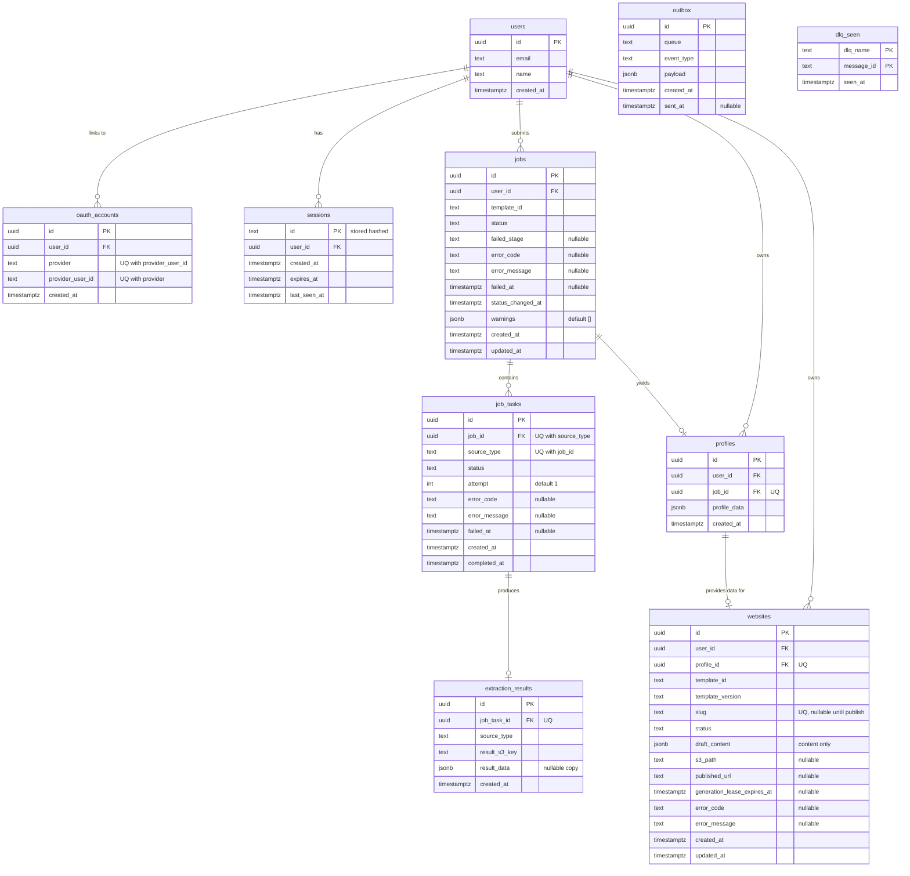

# Database Architecture

**Project:** AI-Powered Personal Website Generator  
**Scope:** MVP / Happy Flow  
**Database:** PostgreSQL  
**Local Environment:** PostgreSQL (Docker)  
**AWS Environment:** Amazon RDS for PostgreSQL

## 1. Purpose

This document describes the database architecture of the AI-Powered Personal Website Generator.

It defines the database technology, logical data model, entity relationships, data ownership boundaries, persistence strategies, and integrity constraints.

The database architecture supports the application's main workflows:

- User authentication through Google and GitHub OAuth, with server-side sessions.
- Portfolio generation job creation and tracking.
- Asynchronous AI processing task management.
- Storage and aggregation of extracted professional information.
- Generated website draft management.
- Asynchronous website publishing and unique subdomain allocation.
- Per-user data deletion.

The objective is to provide a consistent persistence model that supports independent service development while preserving data integrity and clearly defined ownership boundaries.

Final SQL definitions, migrations and indexes are written during implementation, following the model described here.

---

## 2. Database Technology and Persistence Strategy

### 2.1 Primary Database — PostgreSQL

PostgreSQL is the application's primary relational database.

It stores structured application data, including:

- Users, external authentication identities and sessions.
- Portfolio processing jobs.
- Individual AI processing tasks.
- Extraction result records.
- Unified professional profiles.
- Generated website drafts.
- Website publishing metadata.
- Outbox rows and DLQ bookkeeping.

PostgreSQL provides relational integrity, transactional consistency, uniqueness constraints, and support for JSONB documents.

### 2.2 Relational Data and JSONB

The application uses a hybrid persistence approach.

**Relational tables** are used for entities with clearly defined relationships and transactional requirements, such as users, sessions, processing jobs, tasks, and website metadata.

**JSONB columns** are used for complex or flexible data structures that may evolve as extraction and generation capabilities improve:

- Unified professional profiles.
- Generated website drafts.
- An optional copy of structured extraction results.
- Job warnings.

JSONB does not replace the shared JSON Schemas defined in the communication contracts. The application validates these documents before persistence and consumption.

### 2.3 Object Storage — Amazon S3

Large documents and static assets are stored outside PostgreSQL.

Amazon S3 is used for:

- Uploaded CV documents.
- User-exported LinkedIn PDF documents.
- Structured AI extraction results (the S3 object is the source of truth).
- Published website files and assets.

PostgreSQL stores the metadata and references required to associate these objects with application records.

---

## 3. High-Level Database Architecture

The database model is organized around authentication, job orchestration, profile aggregation, website management and reliability bookkeeping.

### 3.1 Database Diagram

*Note: this image is not fully up to date. It does not show `sessions`, `websites.template_version` or the `outbox` tables. The Mermaid diagram below is current.*

The central workflow follows these relationships:

1. A user authenticates through one or more OAuth accounts and receives a session.
2. A user submits portfolio processing jobs.
3. Each job contains the processing tasks required for the submitted sources.
4. Each successfully completed task produces an extraction result.
5. A completed job produces a unified professional profile.
6. The unified profile provides the data required to generate a website.
7. The generated website belongs to the user and may subsequently be published.

### 3.2 Database Table Overview

| Table | Responsibility | Owner |
| --- | --- | --- |
| `users` | Store application users | Auth Module |
| `oauth_accounts` | Store external authentication identities | Auth Module |
| `sessions` | Store server-side login sessions | Auth Module |
| `jobs` | Track portfolio generation workflows | Job Orchestrator |
| `job_tasks` | Track individual AI processing tasks | Job Orchestrator |
| `extraction_results` | Reference or store extracted structured information | Job Orchestrator |
| `profiles` | Store unified professional profiles | Profile Aggregator |
| `websites` | Store generated website drafts and publishing metadata | Website Service |
| `outbox` (Core) | Transactional outbox for events Core publishes | Core Backend |
| `outbox` (Website Service) | Transactional outbox for events the Website Service publishes | Website Service |
| `dlq_seen` | Record dead-letter messages already handled | Core Backend |

The Core Backend Service owns the user, session, job, task, result and profile tables, plus its outbox and `dlq_seen`.

The Website Service owns the `websites` table and its own outbox.

All tables live in the shared PostgreSQL database infrastructure, while ownership remains logically separated by service responsibility.

---

## 4. Data Ownership and Service Boundaries

Data ownership determines which component is responsible for creating, modifying, and maintaining each database entity.

Although multiple services may use the same PostgreSQL infrastructure, they must respect the defined ownership boundaries.

### 4.1 Core Backend Service Ownership

The Core Backend Service owns the following tables:

**Authentication Module**

- `users`
- `oauth_accounts`
- `sessions`

**Job Orchestration Module**

- `jobs`
- `job_tasks`
- `extraction_results`
- `outbox`
- `dlq_seen`

**Profile Aggregation Module**

- `profiles`

These modules belong to the same deployable Core Backend Service.

They communicate internally and do not require additional HTTP interfaces to interact with each other.

### 4.2 Website Service Ownership

The Website Service owns:

- `websites`
- its own `outbox`

It is responsible for:

- Creating generated website records.
- Storing unpublished website drafts.
- Managing website generation and publication states.
- Reserving unique subdomains.
- Recording published website URLs and S3 locations.

The Website Service reads unified profile data produced by the Core Backend Service.

It must not modify profiles or other data owned by Core Backend.

### 4.3 AI Processing Services

The following services do not directly access the PostgreSQL database:

- CV Extraction Service.
- GitHub Analysis Service.
- LinkedIn Extraction Service.

These services receive processing requests through Amazon SQS.

They store structured results in private Amazon S3 storage and publish completion events.

The Core Backend Service is responsible for retrieving and persisting the corresponding result information.

### 4.4 Shared Database Considerations

The MVP uses a shared PostgreSQL database with logical data ownership boundaries.

Cross-service access is limited to the responsibilities established in the architecture.

In particular, the Website Service has read access to unified profiles while maintaining ownership of website-related records.

Database permissions enforce these responsibilities where practical.

---

## 5. Detailed Database Schema

### 5.1 Entity-Relationship Diagram

The ER diagram in section 3.1 presents the tables and attributes, primary keys (PK), foreign keys (FK), unique constraints (UQ), relationships and cardinalities.

### 5.2 Users Table

**Table:** `users`  
**Owner:** Core Backend / Authentication Module

Stores the identity information of application users.

| Field | Purpose |
| --- | --- |
| id | Unique user identifier |
| email | User email address |
| name | Display name |
| created\_at | Account creation timestamp |

The user identifier is referenced by other application entities.

A user may submit multiple processing jobs, own multiple unified profiles, and own multiple generated websites.

### 5.3 OAuth Accounts Table

**Table:** `oauth_accounts`  
**Owner:** Core Backend / Authentication Module

Stores the association between application users and their external OAuth identities.

| Field | Purpose |
| --- | --- |
| id | Unique OAuth account identifier |
| user\_id | Associated application user |
| provider | Authentication provider |
| provider\_user\_id | User identifier from the external provider |

Supported authentication providers:

- Google
- GitHub

A user may be associated with multiple OAuth accounts.

A uniqueness constraint on `(provider, provider_user_id)` prevents the same external identity from being associated with multiple local OAuth account records.

OAuth access and refresh tokens are not stored. The login flow reads the profile once and discards the tokens.

### 5.4 Jobs Table

**Table:** `jobs`  
**Owner:** Core Backend / Job Orchestration Module

Represents a portfolio generation workflow initiated by a user.

| Field | Purpose |
| --- | --- |
| id | Unique processing job identifier |
| user\_id | User who initiated the job |
| template\_id | Template chosen at upload, read when `profile.ready` is published |
| status | Overall processing status |
| created\_at | Job creation timestamp |
| updated\_at | Last status update |

A job coordinates source extraction, profile aggregation, and website generation.

Each job belongs to one user.

Each job creates processing tasks only for the sources submitted by that user.

Job statuses: `QUEUED`, `PROCESSING`, `AGGREGATING`, `GENERATING`, `PREVIEW_READY`, `PUBLISHING`, `PUBLISHED`, `FAILED`. Task statuses: `PENDING`, `COMPLETED`, `FAILED` (no task-level `PROCESSING`). Website statuses: `GENERATING`, `GENERATION_FAILED`, `PREVIEW_READY`, `PUBLISHING`, `PUBLISH_FAILED`, `PUBLISHED`, `UNPUBLISHED`. Allowed transitions are in the Core Backend Service document.

### 5.5 Job Tasks Table

**Table:** `job_tasks`  
**Owner:** Core Backend / Job Orchestration Module

Represents an individual AI processing operation belonging to a processing job.

| Field | Purpose |
| --- | --- |
| id | Unique task identifier |
| job\_id | Associated processing job |
| source\_type | CV, GITHUB, or LINKEDIN |
| status | Task processing state |
| attempt | Attempt counter, starts at 1; a retry increments it so stale results can be dropped |
| created\_at | Task creation timestamp |
| completed\_at | Task completion timestamp |

A processing job may contain multiple tasks.

Supported source types:

- `CV`
- `GITHUB`
- `LINKEDIN`

Only requested sources generate tasks.

For example, if the user submits a CV and GitHub username but no LinkedIn document, the job contains only CV and GitHub processing tasks.

The constraint `UNIQUE(job_id, source_type)` limits each job to one task per source type. A repeated processing attempt reuses the same logical task and increments `attempt`.

### 5.6 Extraction Results Table

**Table:** `extraction_results`  
**Owner:** Core Backend / Job Orchestration Module

Stores the result information associated with successfully completed AI processing tasks.

| Field | Purpose |
| --- | --- |
| id | Unique extraction result identifier |
| job\_task\_id | Associated processing task |
| source\_type | Original information source |
| result\_s3\_key | S3 object key of the stored result, relative to the `extraction-results` bucket (from `resultS3Key`) |
| result\_data | Optional validated JSONB copy of the result (nullable) |
| created\_at | Result creation timestamp |

Structured extraction output is stored in private S3 storage, and the `processing.completed` event carries the result reference.

PostgreSQL stores the S3 reference (`result_s3_key`, required) and, where convenient for aggregation, a validated JSONB copy (`result_data`, nullable). The S3 object is the source of truth.

A unique constraint on `job_task_id` prevents duplicate authoritative result records for the same logical task.

### 5.7 Profiles Table

**Table:** `profiles`  
**Owner:** Core Backend / Profile Aggregation Module

Stores the unified professional profile produced by combining completed extraction results.

| Field | Purpose |
| --- | --- |
| id | Unique profile identifier |
| user\_id | Profile owner |
| job\_id | Processing job that produced the profile |
| profile\_data | Unified professional profile (JSONB) |
| created\_at | Profile creation timestamp |

The `profile_data` column follows the `UnifiedProfile` contract.

It may contain:

- Personal information.
- Professional summary.
- Work experience.
- Education.
- Technical skills.
- Projects.
- Certifications.
- Languages.
- Supporting source information and provenance.

A `UNIQUE(job_id)` constraint enforces one authoritative unified profile per processing job.

The columns `id`, `job_id` and `user_id` are the single source of truth. `profile_data` does not repeat `profileId`, `jobId` or `userId`; it holds `schemaVersion`, `sourceTypes`, `profile` and `provenance`.

The Website Service retrieves this information for website generation.

### 5.8 Websites Table

**Table:** `websites`  
**Owner:** Website Service

Stores generated website drafts, configurations, and publishing metadata.

| Field | Purpose |
| --- | --- |
| id | Unique website identifier |
| user\_id | Website owner |
| profile\_id | Associated unified profile |
| template\_id | Selected website template |
| template\_version | Version of the template package used for the draft |
| slug | Unique public subdomain identifier |
| status | Website generation/publishing state |
| draft\_content | Generated website draft (JSONB) |
| s3\_path | Published website storage location |
| published\_url | Public website URL |
| created\_at | Record creation timestamp |
| updated\_at | Last modification timestamp |

The generated draft content is stored in `draft_content` (`schemaVersion` and `content` only; ids and status live in the table columns, which are authoritative).

During preview:

- The website remains unpublished.
- The slug may be NULL.
- The published URL may be NULL.
- Published S3 asset references may be NULL.

Publishing is asynchronous:

1. The user selects a slug and calls the publish endpoint.
2. The Website Service validates the slug.
3. In one transaction, PostgreSQL moves the website to `PUBLISHING` (compare-and-set), reserves the slug, and writes an outbox row for `website.publish.requested`. The HTTP call returns `202 Accepted`.
4. The Website Publisher consumes the event, renders the site with the render worker, and uploads the static files to S3, with `index.html` last.
5. The website is marked `PUBLISHED` and the publishing metadata is updated.

A globally unique constraint on `slug` is mandatory. It is the authoritative mechanism for preventing two websites from using the same subdomain.

### 5.9 Failure-Handling Columns and Tables

| Table | Columns |
| --- | --- |
| `jobs` | `failed_stage`, `error_code`, `error_message`, `failed_at`, `status_changed_at` (used by the watchdog), `warnings` (JSONB array, default `[]`; skipped optional sources) |
| `job_tasks` | `attempt` (integer, default 1), `error_code`, `error_message`, `failed_at` |
| `websites` | `generation_lease_expires_at`, `error_code`, `error_message`; **`UNIQUE(profile_id)`** (one website per profile) |
| `outbox` | `id`, `queue`, `event_type`, `payload` (JSONB), `created_at`, `sent_at` (NULL until published) |
| `dlq_seen` | `dlq_name`, `message_id` (primary key together), `seen_at` |

Status transitions use a compare-and-set, for example `UPDATE jobs SET status = :new WHERE id = :id AND status = ANY(:allowed_from)`.

### 5.10 Sessions, Publishing, Slug Takeover and Data Deletion

| Table | Detail |
| --- | --- |
| `sessions` | `id` (random, stored hashed), `user_id`, `created_at`, `expires_at`, `last_seen_at`. The httpOnly cookie `pf_session` holds the session id; it is host-only (no `Domain=` attribute). OAuth tokens are **not** stored anywhere (GitHub analysis uses one server-side token from the secret manager). |
| `jobs` | `template_id` (the template chosen at upload). Status values include `PUBLISHING` and `PUBLISHED`. |
| `websites` | `template_version`. Status values: `GENERATING`, `GENERATION_FAILED`, `PREVIEW_READY`, `PUBLISHING`, `PUBLISH_FAILED`, `PUBLISHED`, `UNPUBLISHED`. |
| `outbox` (Website Service) | Same columns as the Core `outbox`. The Website Service queues `website.publish.requested` through it and publishes `website.generated`, `website.published` and `website.failed` through the same outbox and relay. |

Rules:

- **Slug takeover:** in one transaction the owner's older website with that slug becomes `UNPUBLISHED` and its `slug` is set to NULL, and the newer website claims the slug. `UNIQUE(websites.slug)` stays the authority; a slug owned by another user is `SLUG_TAKEN` (`409`). Slugs cannot be renamed after the first publish in v1.
- **Async publish:** `PUBLISHING` is set by compare-and-set from `PREVIEW_READY` or `PUBLISH_FAILED` when `website.publish.requested` is queued; a failed publish sets `PUBLISH_FAILED` and the job returns to `PREVIEW_READY`.
- **Task statuses** are `PENDING`, `COMPLETED`, `FAILED`; `job_tasks.attempt` drops stale results after a retry.
- **Data deletion:** `DELETE /api/me` removes the user's rows (sessions, oauth accounts, jobs, tasks, results, profiles, websites), the S3 objects under the user's keys and the published files; sessions are removed first.
- Source warnings live only in `jobs.warnings` (entries `{sourceType, errorCode, message}`), not inside the profile JSON.
- "My sites" (`GET /api/websites`) reads `websites` by `user_id`.

---

## 6. Entity Relationships and Cardinalities

The database relationships connect users, processing workflows, extracted information, and generated websites.

| Parent | Relationship | Child | Cardinality |
| --- | --- | --- | --- |
| users | links to | oauth\_accounts | 1:N |
| users | has | sessions | 1:N |
| users | submits | jobs | 1:N |
| users | owns | profiles | 1:N |
| users | owns | websites | 1:N |
| jobs | contains | job\_tasks | 1:N |
| job\_tasks | produces | extraction\_results | 1:0..1 |
| jobs | yields | profiles | 1:0..1 |
| profiles | provides data for | websites | 1:0..1 (`UNIQUE(websites.profile_id)`) |

### 6.1 Authentication Relationships

A user may authenticate using multiple supported OAuth providers.

Each OAuth account belongs to exactly one application user. Each session belongs to one user.

### 6.2 Job Processing Relationships

A user may create multiple processing jobs.

Each job belongs to one user and contains the processing tasks corresponding to the submitted sources.

A processing task produces at most one authoritative extraction result.

### 6.3 Profile Relationships

A processing job may produce one unified profile after successful aggregation.

A user may have multiple profiles generated from different jobs.

Each unified profile belongs to one user and is associated with its originating job.

### 6.4 Website Relationships

A user may own multiple generated websites.

Each website references the unified profile used for its generation.

Under `UNIQUE(websites.profile_id)` a profile has at most one website. Generating a site with a different template means a new job and a new profile.

The application verifies that the referenced profile belongs to the same user as the website.

### 6.5 Referential Integrity

Foreign keys enforce relationships within the Core Backend's own tables.

Cross-service foreign keys involving the Website Service (`websites.user_id`, `websites.profile_id`) are part of the logical model. Their physical enforcement is decided in the migration design; until then the Website Service verifies ownership in application code.

The system must not rely exclusively on application-level assumptions to preserve data integrity.

---

## 7. Database Constraints and Integrity

### 7.1 Primary Keys

Every table has a primary key named `id` (except `dlq_seen`, whose key is `dlq_name` + `message_id`).

Identifiers are UUIDs, except session ids, which are random tokens stored hashed.

### 7.2 Foreign Keys

Foreign keys associate dependent records with their parent entities.

Examples include:

- `oauth_accounts.user_id` → `users.id`
- `sessions.user_id` → `users.id`
- `jobs.user_id` → `users.id`
- `job_tasks.job_id` → `jobs.id`
- `extraction_results.job_task_id` → `job_tasks.id`
- `profiles.job_id` → `jobs.id`
- `profiles.user_id` → `users.id`
- `websites.profile_id` → `profiles.id`
- `websites.user_id` → `users.id` (cross-service; see 6.5)

### 7.3 Unique Constraints

| Constraint | Purpose |
| --- | --- |
| UNIQUE(websites.slug) | Prevent duplicate subdomains (authoritative) |
| UNIQUE(oauth\_accounts.provider, provider\_user\_id) | Prevent duplicate OAuth identities |
| UNIQUE(job\_tasks.job\_id, source\_type) | Prevent duplicate source tasks per job |
| UNIQUE(extraction\_results.job\_task\_id) | One authoritative result per task |
| UNIQUE(profiles.job\_id) | One authoritative profile per job |
| UNIQUE(websites.profile\_id) | One website per unified profile; makes `profile.ready` duplicate-safe |

### 7.4 Status Validation

Status fields accept only the supported application states listed in 5.4.

Invalid or backward state transitions are prevented by the owning service using compare-and-set updates.

### 7.5 Nullability

Required references must be present for valid persisted records.

Fields that become available only after processing or publication may remain NULL until the corresponding operation succeeds.

For example, a website does not require a public slug during the preview stage.

---

## 8. Database Indexing Strategy

Indexes support the application's most common query patterns.

| Table | Field(s) | Purpose |
| --- | --- | --- |
| oauth\_accounts | provider, provider\_user\_id | OAuth account lookup |
| sessions | user\_id, expires\_at | Session lookup and expiry cleanup |
| jobs | user\_id | Retrieve a user's jobs |
| jobs | status, status\_changed\_at | Watchdog scan for stuck jobs |
| job\_tasks | job\_id | Retrieve tasks belonging to a job |
| extraction\_results | job\_task\_id | Retrieve a task's extraction result |
| profiles | job\_id | Retrieve a profile generated by a job |
| websites | user\_id | "My sites" list |
| websites | profile\_id | Identify websites generated from a profile |
| websites | slug | Enforce globally unique subdomains |
| outbox | sent\_at (where NULL) | Relay picks up unsent rows |

Primary key and unique constraints already create supporting indexes in PostgreSQL, so duplicate indexes are not introduced.

Additional indexes may be added after observing real query patterns.

JSONB-specific indexes are not required by default.

---

## 9. Data Persistence and Application Workflow

### 9.1 User Authentication

The user authenticates using Google or GitHub OAuth.

The Authentication Module creates or retrieves the appropriate `users` record, associates it with an `oauth_accounts` record, and creates a `sessions` row. The session id is returned in the httpOnly `pf_session` cookie.

### 9.2 Processing Job Creation

After successful source validation, the Job Orchestration Module creates a record in `jobs`.

It then creates the required records in `job_tasks`, and writes the request events to the `outbox` in the same transaction. A relay publishes them to the corresponding SQS queues.

### 9.3 AI Processing Results

Each AI Processing Service performs its assigned extraction or analysis independently.

After processing:

1. The service stores its structured JSON result in S3.
2. It publishes `processing.completed`.
3. Core Backend consumes the event.
4. The result is validated and recorded in `extraction_results`.
5. The corresponding task status is updated.

### 9.4 Profile Aggregation

When every requested task is terminal and the CV task has completed, the Job Orchestrator triggers profile aggregation internally.

The Profile Aggregation Module:

1. Retrieves the completed extraction results.
2. Combines the available professional information.
3. Removes duplicate information.
4. Resolves overlapping information according to the aggregation policy.
5. Stores the unified profile in `profiles.profile_data`.
6. Publishes `profile.ready` through the outbox.

### 9.5 Website Generation

The Website Service consumes `profile.ready`.

It reads the unified profile, retrieves the selected template, and generates the website draft.

The generated draft is stored in `websites.draft_content`.

The Website Service publishes `website.generated` after successful persistence.

### 9.6 Website Publication

After user approval, the Website Service receives an authorized HTTP publishing request.

In one transaction it sets the website to `PUBLISHING`, reserves the requested slug and writes a `website.publish.requested` outbox row. It returns `202 Accepted`.

The Website Publisher then renders the static files, uploads them to S3 and updates the website metadata in PostgreSQL.

After successful publication, the Website Service publishes `website.published`. On failure it publishes `website.failed` with `stage = WEBSITE_PUBLISHING`, the website becomes `PUBLISH_FAILED`, and the job returns to `PREVIEW_READY`.

The Core Backend receives the event and exposes the final website URL to the Frontend through job status polling.

---

## 10. Transactions, Concurrency, and Consistency

### 10.1 Transactional Operations

PostgreSQL transactions are used for operations that require multiple related database changes to succeed together.

Examples include:

- Creating a processing job, its required tasks and its outbox rows.
- Updating task status and recording its authoritative result.
- Persisting a unified profile and its corresponding workflow state.
- Starting a publish: status change, slug reservation and outbox row.
- Slug takeover.

### 10.2 Concurrent Processing

AI Processing Services execute independently.

Completion events may arrive in any order.

The Job Orchestrator determines aggregation readiness using persisted task states rather than event arrival order.

It also prevents duplicate aggregation when multiple completion events are processed concurrently.

### 10.3 Idempotency

Amazon SQS Standard may deliver messages multiple times.

Therefore, database operations triggered by events are idempotent.

Examples:

- A processing task does not create duplicate authoritative results.
- A job does not create duplicate unified profiles.
- Repeated `profile.ready` events do not create multiple websites (`UNIQUE(profile_id)`).
- Repeated publish requests do not reserve multiple slugs for the same logical publication, and a repeated `website.publish.requested` does not publish twice (compare-and-set on status).

Database uniqueness constraints and atomic operations support these requirements.

### 10.4 Cross-System Consistency

The application uses PostgreSQL, Amazon S3, and Amazon SQS.

These systems do not participate in one shared atomic transaction.

For example, writing a website to S3 and updating its publication state in PostgreSQL are separate operations.

The transactional outbox covers the PostgreSQL-to-SQS boundary. A relay crash can publish an event twice, which consumers tolerate. Publishing uploads `index.html` last and can be repeated safely, and the DLQ listener and the Core watchdog recover work that stops part-way.

---

## 11. Security and Access Control

### 11.1 Database Access

Database access is restricted to authorized application components.

Services receive only the permissions necessary for their responsibilities.

The Website Service has read-only access to Core-owned profile data and write access to its own website records.

AI Processing Services do not need direct PostgreSQL access.

### 11.2 Sensitive Information

The database contains personal and professional information.

Sensitive data must be protected from unauthorized access.

The application must not expose:

- Another user's professional profile.
- Private processing results.
- Authentication credentials.
- Internal storage references that would permit unauthorized access.

User ownership is validated before accessing user-specific records.

### 11.3 Database Credentials

Database credentials are configured securely.

They are not hardcoded or committed to Git repositories.

Local development and AWS deployment use environment-appropriate secret configuration.

### 11.4 Data Retention and Deletion

Uploaded documents and extracted professional information may contain personal data.

A user can delete their account with `DELETE /api/me`. Deletion removes the user's rows, the S3 objects under the user's keys and the user's published files (see 5.10).

---

## 12. Local and AWS Database Environments

The application follows a local-first development strategy.

### 12.1 Local Environment

Local development uses PostgreSQL running in Docker.

Docker Compose starts the required database infrastructure alongside the application services.

The environment supports:

- Local application development.
- Database migrations.
- Integration testing.
- Contract testing.
- End-to-end Happy Flow verification.

### 12.2 AWS Environment

AWS deployment uses Amazon RDS for PostgreSQL.

The infrastructure is provisioned using Terraform.

The same logical database model, constraints, and application behavior are preserved between local and AWS environments.

### 12.3 Database Migrations

Database schema changes are version-controlled and applied through a repeatable migration process.

Each migration has a clearly identified owner.

Because the database contains tables owned by different service modules, migrations respect these ownership boundaries.

---

## 13. Out of Scope for v1

- Editing profiles after generation and profile versioning.
- Multiple drafts or versions of one website; a different template means a new job.
- Renaming a slug after the first publish.
- Backup and restore procedures and database monitoring targets, which are defined with the infrastructure.
